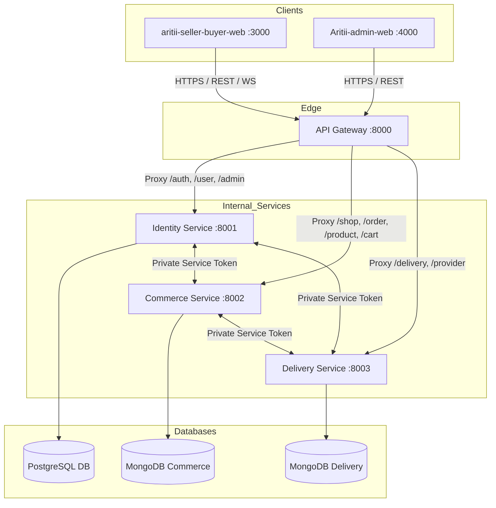
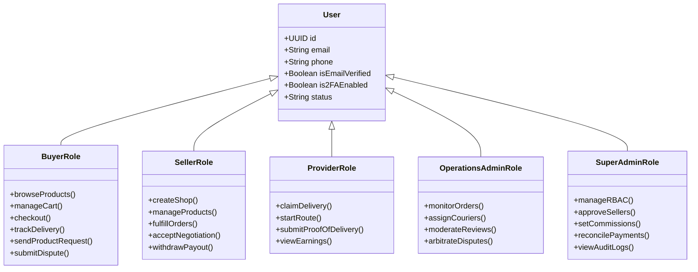
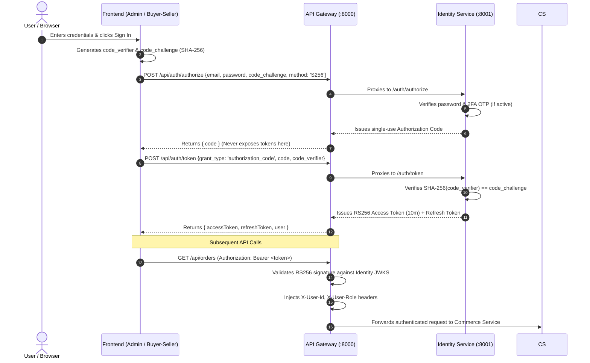
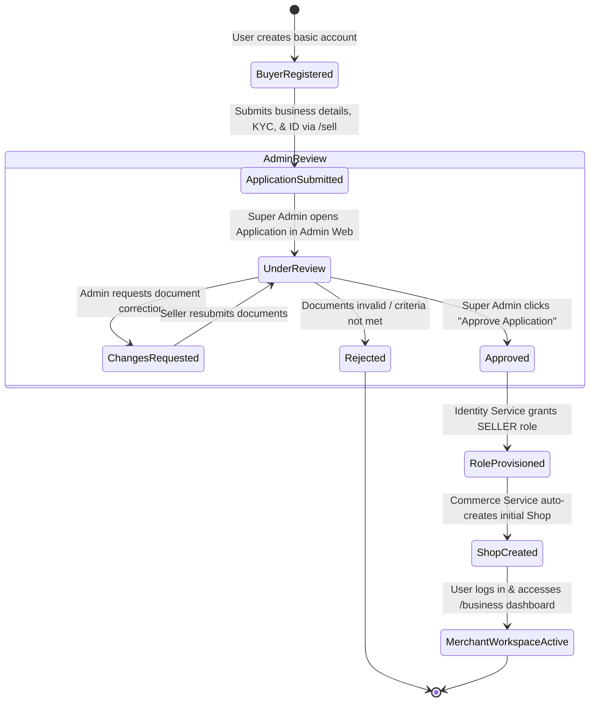
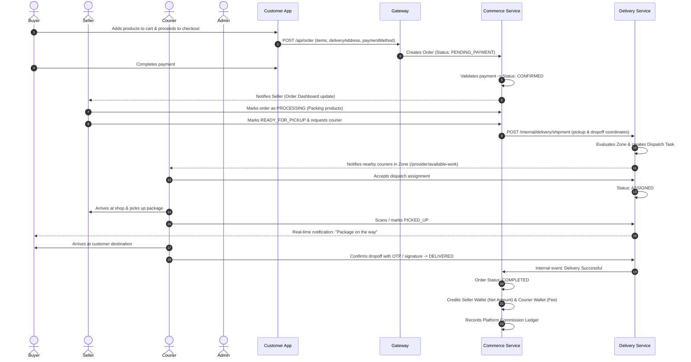

# Aritii Multi-Seller Marketplace — Comprehensive Platform Architecture & Presentation Report

> **Confidential & Presentation Ready**  
> **Prepared for:** Executive Leadership, Technical Stakeholders & Platform Presentation  
> **Coverage:** Full-Stack Ecosystem (`backend-micro`, `Aritii-admin-web`, `aritii-seller-buyer-web`)  
> **Status:** Production Architecture Blueprint & Feature Matrix  

---

## 1. Executive Summary

**Aritii Market** is an enterprise-grade, multi-seller, multi-portal digital marketplace ecosystem engineered to support hyper-local and cross-regional commerce. The platform seamlessly bridges four primary user personas:
1. **Buyers (Consumers):** Discover, purchase, track goods, and negotiate custom orders.
2. **Sellers (Merchants / Businesses):** Manage multi-shop retail operations, catalog inventories, order fulfillment, promotions, and financials.
3. **Delivery Providers (Logistics & Riders):** Execute route-optimized last-mile deliveries, claim available batch orders, and track earnings.
4. **Platform Administrators (Ops & Super Admins):** Maintain governance, enforce role-based security, monitor real-time SLA metrics, arbitrate disputes, configure commission rates, and manage platform finances.

The system is constructed with a decoupled microservices backend and two responsive, high-performance frontends that communicate exclusively through a unified, hardened API Gateway.

```
+========================================================================================+
|                                    ARITII ECOSYSTEM                                    |
+========================================================================================+
|                                                                                        |
|  [ Customer & Merchant Web ]                   [ Admin Operations Web ]                |
|  (Buyer, Seller, Provider)                     (Super Admin & Operations Admin)        |
|  React 18 + Redux + Tailwind                   React 18 + Vite + TypeScript + Tailwind |
|               \                                       /                                |
|                \                                     /                                 |
|                 v                                   v                                  |
|            +---------------------------------------------+                             |
|            |      API GATEWAY (Express / Port 8000)      |                             |
|            |      OAuth 2.1 + PKCE / RS256 Validation    |                             |
|            |      Reverse Proxy / Rate Limiter / Docs    |                             |
|            +---------------------------------------------+                             |
|                    /              |               \                                    |
|                   v               v                v                                   |
|         +----------------+ +---------------+ +------------------+                      |
|         |    IDENTITY    | |   COMMERCE    | |     DELIVERY     |                      |
|         |    SERVICE     | |    SERVICE    | |     SERVICE      |                      |
|         |  (Port 8001)   | |  (Port 8002)  | |   (Port 8003)    |                      |
|         |   PostgreSQL   | |    MongoDB    | |     MongoDB      |                      |
|         +----------------+ +---------------+ +------------------+                      |
|                                                                                        |
+========================================================================================+
```

---

## 2. High-Level Architecture & System Boundaries

### 2.1 Physical Repositories

| Repository / Directory | Technology Stack | Hosting / Port | Primary Role |
|---|---|---|---|
| **`Ariti-backend/backend-micro`** | Node.js (Express), PostgreSQL (Sequelize), MongoDB (Mongoose), Redis/In-Memory Cache, Docker | Port `8000` (Gateway public), `8001` (Identity), `8002` (Commerce), `8003` (Delivery) | Core business engine, data persistence, event processing, auth server, API proxy |
| **`Admin-web/Aritii-admin-web`** | React 18, Vite, TypeScript, React Router 6/7, Tailwind CSS, Axios, Lucide Icons | Port `4000` (Dev) | Central control center for Platform Owners, Operations Admins, Compliance, and Finance |
| **`aritii-seller-buyer-web`** | React 18, Vite, JavaScript, Redux Toolkit, React Router 6, Tailwind CSS | Port `3000` (Dev) | Unified client portal: Public Marketplace, Buyer Account Hub, Merchant Workspace, and Courier Portal |

---

### 2.2 Microservices & Persistence Breakdown



#### 1. API Gateway (`api-gateway/`)
* **Role:** Single public ingress point (Port `8000`). All downstream microservices remain inside isolated private subnets.
* **Key Responsibilities:**
  * Segment-aware URI matching (`/auth`, `/user`, `/shop`, `/product`, `/order`, `/delivery`, `/admin`).
  * JWT RS256 token verification using OIDC JWKS (`/.well-known/jwks.json`).
  * Strips untrusted user headers (`X-User-*`) from inbound public requests; securely injects verified identity claims (`X-User-Id`, `X-User-Role`, `X-User-Email`) before upstream proxying.
  * Inter-service security gating with per-caller `INTERNAL_SERVICE_TOKENS`.
  * OpenAPI 3.0 (Swagger) generation and interactive documentation (`/api/docs`).
  * Microservice liveness and readiness monitoring (`/health/live`, `/health/ready`).

#### 2. Identity Service (`identity-service/`)
* **Persistence:** PostgreSQL with Sequelize ORM.
* **Role:** Authentication authority, OIDC Identity Provider (IdP), and Role-Based Access Control (RBAC).
* **Key Capabilities:**
  * OAuth 2.1 Authorization Code Flow with mandatory PKCE (SHA-256 code challenge/verifier).
  * RS256 asymmetric cryptographic key rotation for signing JWT tokens.
  * Rotating Refresh Tokens with token family reuse-detection for session revocation.
  * Email One-Time Password (OTP) 2-Factor Authentication (2FA) and password recovery.
  * Unified User Model: Single account record backing multiple capabilities (Buyer, Seller, Provider, Admin).
  * Granular RBAC tables: `roles`, `permissions`, `role_permissions`, and `admin_user_roles`.

#### 3. Commerce Service (`commerce-service/`)
* **Persistence:** MongoDB with Mongoose ODM.
* **Role:** Multi-vendor transactional commerce, multi-store retail, inventory, and order fulfillment.
* **Key Capabilities:**
  * **Business & Multi-Shop Hierarchy:** Supports a parent business managing multiple distinct shops with independent operating hours, addresses, and staff.
  * **Catalog & Products:** Variant configurations, pricing rules, SKUs, inventory reservations, tags, and category taxonomies.
  * **Order Fulfillment Pipeline:** Full order state machine (`PENDING` -> `CONFIRMED` -> `PROCESSING` -> `READY_FOR_PICKUP` -> `DISPATCHED` -> `DELIVERED`).
  * **Phase-1 Order Operations:** Order Holds, Priority Queueing, SLA Breach Tracking, Order Activity Logs/Notes.
  * **Product Request System:** Direct negotiation engine allowing buyers to submit custom product inquiries and sellers to respond with custom quotes.
  * **Promotions & Coupons:** Cart-level discounts, percentage-off, free shipping rules, and scheduled flash sale events.
  * **Financial Engine:** Merchant digital wallets, payment reconciliation ledger, commission calculations, and payout pipelines.
  * **Content & Governance:** Customer reviews moderation queue and buyer-seller dispute arbitration.

#### 4. Delivery Service (`delivery-service/`)
* **Persistence:** MongoDB with Mongoose ODM.
* **Role:** Logistics orchestration, provider onboarding, spatial routing, and last-mile tracking.
* **Key Capabilities:**
  * **Geographic Expansion & Hierarchy:** Countries -> Regions -> Cities -> Zones -> Ports/Hubs -> Routes.
  * **Provider Onboarding:** Driver/rider application review, verification of driving credentials, vehicle licensing, and zone assignment.
  * **Delivery Dispatching:** Automatic and manual shipment assignment to nearby available couriers.
  * **Batch Deliveries:** Aggregation of multiple orders into high-efficiency delivery batches for couriers.
  * **Real-time Spatial Tracking:** Live status transitions (`ASSIGNED`, `ACCEPTED`, `PICKED_UP`, `IN_TRANSIT`, `DELIVERED`, `FAILED`).
  * **Provider Financials:** Per-delivery earnings, tips calculation, courier digital wallets, and withdrawal history.

---

## 3. Deep Dive: The Frontends

### 3.1 Admin Web (`Admin-web/Aritii-admin-web`)
Built with **React 18 + Vite + TypeScript + Tailwind CSS**, running on port `4000`. It is a secured, desktop-optimized command center for administrators.

#### Architectural Structure:
* **Router:** React Router (`createBrowserRouter`) leveraging React lazy loading, dynamic code-splitting, and error boundaries.
* **Route Guards:**
  * `ProtectedRoute`: Ensures active token session; redirects unauthenticated visitors to `/login`.
  * `RoleRoute`: Evaluates signed-in user's role against required roles, returning a polished `403 Forbidden` screen if unauthorized.
* **API Client:** Dedicated Axios instance (`httpClient.ts`) with automatic bearer-token attachment, base URL switching, and standard error interceptors.
* **Navigation Architecture:** Role-filtered navigation groups in `navigation.ts`:
  * **Dashboard:** Operational metrics, high-level revenue, active orders, and alert feeds.
  * **Users Management:** Multi-tab interface (`All Users`, `Buyers`, `Sellers`, `Customers`, `Admins`).
  * **Businesses & Stores:** Verification workflow for seller business applications and store creation.
  * **Commerce Operations:** Live orders, products catalog, category hierarchies, promotions, review moderation, and buyer-seller requests.
  * **Fulfillment & SLAs:** Priority order queues, SLA breach dashboards, and order notes.
  * **Delivery & Logistics:** Operational deliveries dashboard, courier provider management, delivery requests, and regional location trees.
  * **Disputes & Arbitrations:** Customer complaints, return requests, and mediation tools.
  * **Financials & Ledgers:** Merchant wallets, platform commission settings, payout execution, and payment reconciliation.
  * **Audit Logs:** Immutable audit trail tracking every privileged admin action.
  * **Security & System Settings:** Notification providers (SMTP/SMS), platform switches, and RBAC role definitions.

---

### 3.2 Customer & Seller Web (`aritii-seller-buyer-web`)
Built with **React 18 + Vite + JavaScript + Redux Toolkit + Tailwind CSS**, running on port `3000`. It houses multiple portals within a single, unified web application:

```
src/
├── public/                -> Public storefront, marketing, catalog, seller/driver onboarding
├── buyer/                 -> Customer portal (account, orders, cart, wishlist, address, reviews)
├── business/              -> Merchant workspace (multi-shop, catalog, inventory, orders, finance)
├── features/
│   ├── delivery-provider/ -> Courier portal (active orders, batches, route tracking, wallet)
│   ├── marketplace/       -> Product discovery, search, filtering, category exploration
│   └── provider-app/      -> Driver registration & application tracking
├── auth/                  -> Global login modal, sign-up, password reset, 2FA validation
└── store/redux/           -> Global state management (user, cart, orders, wishlist)
```

#### The Four Portal Experiences:
1. **Public Marketplace (`/`, `/marketplace`, `/products`, `/shops`, `/categories`)**:
   * Open to unauthenticated and authenticated users.
   * Universal search bar, top utility bar with location switcher ("Deliver to: City/Zone"), deals carousel, and store discovery.
2. **Buyer Dashboard (`/my-dashboard`, `/checkout`, `/payment`, `/user/track/order/:id`)**:
   * Gated by `ProtectedRoute require="BUYER"`.
   * Order histories, live delivery tracking maps, address book, saved cards, product inquiries, and returns.
3. **Business / Seller Workspace (`/business/*`)**:
   * Gated by `ProtectedRoute require="BUSINESS"`.
   * Complete seller enterprise portal with sidebar navigation: Dashboard, Shops, Products, Inventory, Orders, Refunds, Promotions, Events, Requests, Analytics, and Finance.
4. **Delivery Provider Workspace (`/provider/*`)**:
   * Gated by `ProtectedRoute require="PROVIDER"`.
   * Mobile-responsive logistics portal: Available work feed, active deliveries, route batches, delivery confirmation, warnings, and earnings wallet.

---

## 4. User Roles & Detailed Functionality Matrix

The platform implements an explicit Role-Based Access Control (RBAC) structure. Each user belongs to one or more roles that grant access to specific functionality across the frontends and backend services.



---

### 4.1 Guest / Public Visitor
* **Permissions:** Public read-only access.
* **Capabilities:**
  * Browse the complete catalog, filter by categories, price ranges, ratings, and active discounts.
  * Select delivery location to view products and shops available in their zone.
  * View public merchant storefronts, product specifications, customer reviews, and ratings.
  * Access educational landing pages: "Sell on Aritii" (`/seller-center`) and "Become a Driver" (`/delivery-center`).
  * Add items to guest shopping cart (persisted in local storage / session).

---

### 4.2 Customer / Buyer
* **Permissions:** Authenticated customer rights (`BUYER`).
* **Capabilities:**
  * **Profile & Addresses:** Manage multiple delivery locations (Home, Office) with precise GPS coordinates, phone numbers, and delivery instructions.
  * **Cart & Checkout:** Multi-shop basket aggregation, discount coupon application, selection of delivery speed/zone, and checkout.
  * **Payments:** Seamless transaction completion using supported payment gateways (cards, mobile wallets, or cash on delivery).
  * **Order Tracking:** Real-time visibility into order status transitions, assigned delivery provider name, contact info, and tracking milestones.
  * **Product Request Engine (Negotiation):** Submit custom inquiries for bulk orders, out-of-stock items, or specialized configurations directly to specific shops, negotiating price and quantity through an interactive chat interface.
  * **Reviews & Ratings:** Submit verified-purchase reviews and product ratings (which pass through an automated or admin moderation check).
  * **Disputes & Returns:** Initiate order return or refund requests with photo evidence if items are damaged or defective.

---

### 4.3 Merchant / Seller (`BUSINESS` Capability)
* **Permissions:** Approved business and merchant workspace access.
* **Capabilities:**
  * **Store & Brand Management:** Configure multiple shops under a single business entity; customize logos, banners, operational hours, pickup locations, and policy details.
  * **Product Catalog:** Create and update products, upload multi-angle images, set variant pricing (sizes, colors), and assign SKU codes.
  * **Inventory Control:** Monitor real-time stock levels, receive low-stock alerts, and batch-update product availability.
  * **Order Fulfillment:** Live order dashboard, order acceptance, packing status updates, printing packing slips/shipping labels, and requesting courier dispatch.
  * **Product Request Management:** Receive custom inquiries from buyers, send custom price proposals/quotations, and convert agreed terms directly into payable orders.
  * **Promotions & Marketing:** Create promotional coupon codes, percentage/fixed discounts, minimum order conditions, and participate in platform-wide seasonal events.
  * **Financial Management:** Access business wallet, view gross sales, net revenue (after platform commissions), view transaction ledgers, and trigger payout withdrawal requests to registered business bank accounts.
  * **Refund Handling:** Review customer-initiated return requests, inspect uploaded proof, and approve or dispute refund claims.

---

### 4.4 Delivery Provider / Courier (`PROVIDER` Capability)
* **Permissions:** Verified courier rights.
* **Capabilities:**
  * **Availability Toggle:** Switch between "Online" (available for dispatches) and "Offline".
  * **Available Work Queue:** Inspect open delivery requests in their registered zone; evaluate pickup distance, delivery destination, parcel weight, and delivery fee before accepting.
  * **Active Deliveries Management:** Step-by-step route workflow:
    1. Navigation to merchant shop.
    2. Confirm package pickup (`PICKED_UP`).
    3. Navigation to customer address (`IN_TRANSIT`).
    4. Delivery confirmation with recipient confirmation or Proof of Delivery (`DELIVERED`).
  * **Batched Deliveries:** Accept clustered multi-stop deliveries along shared routes to maximize hourly earnings.
  * **Provider Wallet:** Monitor real-time earnings per completed trip, review platform bonuses and tips, and view withdrawal disbursement history.
  * **Compliance & Ratings:** View customer delivery ratings, on-time delivery metrics, and platform SLA warnings.

---

### 4.5 Operations Administrator (`OPERATIONAL_ADMIN`)
* **Permissions:** Daily administrative execution without system configuration mutation.
* **Capabilities:**
  * **Live Order Control:** Oversee platform-wide orders, track fulfillment bottlenecks, review order notes, and place problematic orders on temporary hold (`order-hold`).
  * **SLA Dashboard:** Real-time monitoring of service level agreements; identify orders approaching or exceeding preparation/delivery deadlines.
  * **Logistics & Dispatch Intervention:** Reassign unassigned shipments or stranded deliveries to available delivery providers; monitor delivery routes.
  * **Review Moderation Queue:** Review flagged or pending customer reviews; approve authentic reviews or reject abusive/spam submissions.
  * **Dispute Arbitration:** Mediate unresolved conflicts between buyers and sellers; review communication logs and issue binding refund approvals or denials.
  * **Support Desk:** Investigate customer and seller operational inquiries and view user profile contexts.

---

### 4.6 Super Administrator (`SUPER_ADMIN`)
* **Permissions:** Total platform authority (Security, RBAC, Governance, and Financials).
* **Capabilities:**
  * **RBAC & User Administration:** Create, modify, and delete admin roles; assign granular permission sets; invite new administrators.
  * **Seller Application Approvals:** Review merchant KYC documents, tax IDs, and commercial registrations; grant official `SELLER` / `BUSINESS` status or reject with notes.
  * **Provider Approvals:** Verify driver's licenses, vehicle registrations, and background checks; approve courier accounts.
  * **Financial Governance & Commissions:** Set platform commission percentages per category or merchant tier; configure minimum payout thresholds; monitor escrow balances.
  * **Payment Reconciliation:** Audit incoming gateway funds against internal merchant and courier ledgers to ensure zero discrepancies.
  * **System Configuration:** Configure notification gateways (SendGrid, Twilio, SMTP), security policies (2FA enforcement, session timeouts), and maintenance banners.
  * **Full Audit Logging:** Access tamper-evident audit logs capturing every administrative action, IP address, timestamp, and payload diff.

---

## 5. End-to-End Business Lifecycles & State Flows

### 5.1 Authentication & OIDC PKCE Security Flow



---

### 5.2 Seller Onboarding & Shop Approval Lifecycle



---

### 5.3 Complete Order-to-Delivery Lifecycle



---

### 5.4 Product Custom Request & Negotiation Pipeline

Unique to the Aritii platform, this feature facilitates B2B and custom consumer trade through structured negotiation:

```
[ Buyer initiates Request ]
         |
         v
Selects target Shop & defines specifications (photos, desired quantity, target unit price)
         |
         v
[ Seller receives notification in /business/requests ]
         |
         +----------------------------------+
         |                                  |
         v                                  v
[ Seller sends Counter-Offer ]     [ Seller Rejects Request ]
(Adjusted price, minimum batch,             |
 delivery time estimate)                    v
         |                              [ Request Closed ]
         v
[ Buyer reviews Offer in /buyer/requests ]
         |
         +----------------------------------+
         |                                  |
         v                                  v
[ Buyer Accepts Quote ]            [ Buyer Declines / Counters ]
         |
         v
[ System converts Quote into a Checkout Order ]
         |
         v
[ Standard Payment & Fulfillment Pipeline ]
```

---

## 6. Financial Architecture, Commissions & Ledgers

The platform features a double-entry financial tracking system that guarantees fiscal transparency between the platform owner, merchants, and couriers.

```
+---------------------------------------------------------------------------------------+
|                                ORDER FINANCIAL ALLOCATION                             |
+---------------------------------------------------------------------------------------+
|                                                                                       |
|   Total Customer Paid: $100.00                                                        |
|   (Items: $90.00, Shipping Fee: $10.00)                                               |
|                                                                                       |
|                     |                                                                 |
|                     +-------------> [ Payment Gateway Deposit ] (Gross Inflow)        |
|                                                  |                                    |
|         +----------------------------------------+---------------------------------+  |
|         |                                        |                                 |  |
|         v                                        v                                 v  |
|  [ Merchant Share ]                     [ Courier Share ]              [ Platform Fee ]|
|  Item Subtotal: $90.00                  Delivery Fee: $10.00           Platform Commission|
|  Less Commission (10%): -$9.00          Less Courier Fee: -$1.50       From Seller:  $9.00|
|  -------------------------              ------------------------       From Courier: $1.50|
|  Net to Seller Wallet: $81.00           Net to Driver Wallet: $8.50    Total Profit: $10.50
|                                                                                       |
+---------------------------------------------------------------------------------------+
```

### Financial Capabilities:
* **Escrow Holding:** Funds remain safely in escrow until the customer or courier confirms delivery completion.
* **Automated Ledgering:** Every penny is logged in the `PaymentLedger` and `CommissionLedger`.
* **Dispute Freezes:** If an order enters dispute, funds are automatically frozen in the merchant wallet until resolution.
* **Payout Workflow:**
  * Sellers and Couriers initiate payout requests when wallet balance exceeds threshold.
  * Super Admin inspects the reconciliation dashboard in the Admin Web.
  * Once approved, payments are dispatched via bank API and receipts are archived in audit logs.

---

## 7. Security & Compliance Safeguards

| Layer | Implementation | Security Benefit |
|---|---|---|
| **Edge Gateway** | Express Rate Limiter, Helmet, CORS whitelisting | Prevents DDoS, brute-force login attempts, and unauthorized cross-origin requests |
| **Authentication** | OAuth 2.1 + PKCE (S256) | Eliminates interception of authorization codes; modern standard replacing legacy OAuth 2.0 |
| **Tokens** | RS256 Asymmetric JWT (10 min expiry) | Microservices verify signatures locally using public JWKS without hitting the Identity DB |
| **Refresh Tokens** | Cryptographic rotation with reuse-detection | If an old refresh token is reused, the entire token family is invalidated immediately |
| **2FA / MFA** | Email OTP Verification | Secures administrator logins and privileged seller financial transactions |
| **Private Plane** | `INTERNAL_SERVICE_TOKENS` | Services reject calls lacking distinct, per-caller internal secrets; backend cannot be bypassed |
| **Header Stripping**| Gateway drops inbound `X-User-*` | External attackers cannot spoof user roles or identities by forging headers |
| **Admin Protection**| Explicit RBAC assignments (Fail-Closed) | Newly created admin accounts have zero permissions until explicitly assigned by a Super Admin |
| **Audit Trails** | Immutable Audit Log persistence | Tracks who modified which resource, when, from which IP, and what changed |

---

## 8. Presentation Guide: Key Slide-by-Slide Talking Points

When presenting this architecture to executives, investors, or engineering leads, use the following outline:

### Slide 1: Executive Vision & Platform Value
* **Message:** "Aritii is not just another e-commerce website; it is an all-in-one commercial platform uniting buyers, multi-shop merchants, logistics riders, and platform administrators into a synchronized ecosystem."
* **Highlight:** Clean separation of concerns with two modern React frontends and a resilient microservices backend.

### Slide 2: Modern Microservices Architecture
* **Message:** "Engineered for high availability, security, and horizontal scalability."
* **Highlight:** The API Gateway acts as the single security perimeter. Microservices (Identity, Commerce, Delivery) communicate over private networks with dedicated tokens.

### Slide 3: Unified Identity & OAuth 2.1 PKCE
* **Message:** "Bank-grade authentication with state-of-the-art OAuth 2.1 standards."
* **Highlight:** PKCE protects users on mobile and web; RS256 token signing enables decentralized verification; explicit role-based access control eliminates unauthorized privilege escalation.

### Slide 4: Multi-Shop Merchant Workspace
* **Message:** "Empowering vendors to operate complex retail operations with ease."
* **Highlight:** A single merchant business can operate multiple shops, manage inventory, execute promotions, fulfill orders, negotiate custom requests, and manage financial payouts.

### Slide 5: Last-Mile Delivery & Spatial Logistics
* **Message:** "Complete control over delivery logistics without dependency on 3rd-party monopolies."
* **Highlight:** Built-in geographic expansion models (zones, hubs, routes), driver onboarding, real-time spatial delivery tracking, and automated batching.

### Slide 6: Administrative Command & Control
* **Message:** "Granular platform governance tailored for compliance and operational speed."
* **Highlight:** Super Admins govern platform policies, RBAC, commissions, and approvals; Operations Admins handle live order fulfillment, SLA breaches, and dispute arbitrations.

### Slide 7: Production Readiness
* **Message:** "Hardened, tested, and containerized for deployment."
* **Highlight:** Docker Compose orchestration, automated health probes (`/health/live`, `/health/ready`), fail-closed security models, and automated Swagger documentation.

---

## 9. Quick-Reference System Specification

```text
========================================================================================
                               ARITII PLATFORM CHEAT SHEET
========================================================================================

DEFAULT PORTS:
  • API Gateway:                  http://localhost:8000
  • Identity Microservice:        http://localhost:8001 (Private)
  • Commerce Microservice:        http://localhost:8002 (Private)
  • Delivery Microservice:        http://localhost:8003 (Private)
  • Customer & Seller Web:        http://localhost:3000
  • Admin Operations Web:         http://localhost:4000
  • Interactive Swagger Docs:     http://localhost:8000/api/docs

CORE DATA STORES:
  • PostgreSQL:                   Identity, Accounts, RBAC, OAuth Credentials
  • MongoDB (Commerce):           Businesses, Shops, Products, Orders, Carts, Requests
  • MongoDB (Delivery):           Zones, Hubs, Providers, Shipments, Routes, Batches

DEFAULT SEEDED ADMIN (Development):
  • Email:                        admin@aritii.com
  • Password:                     Admin@12345
  • Role:                         SUPER_ADMIN (Full Platform Authority)

KEY REPOSITORIES:
  1. Ariti-backend/backend-micro   -> Core Microservices, Gateway & Databases
  2. Admin-web/Aritii-admin-web    -> React 18 / Vite / TypeScript Admin Console
  3. aritii-seller-buyer-web       -> Multi-portal Client (Buyer, Seller, Courier)
========================================================================================
```

---
*Report generated and validated for the Aritii Marketplace platform.*
